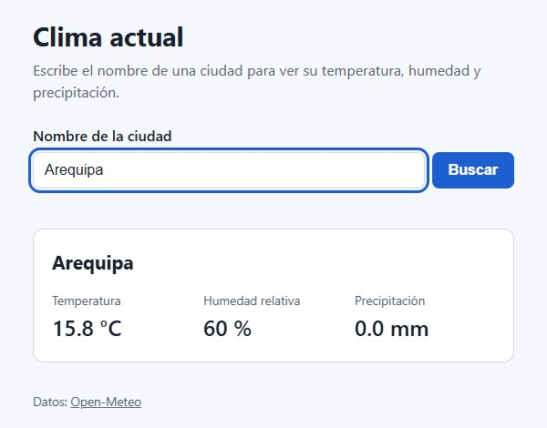

# Clima actual

Laboratorio de desarrollo guiado por especificaciones con Kiro (octubre de 2026). La app pide el nombre de una ciudad, la convierte en coordenadas con la API de geocodificación de Open-Meteo y muestra la temperatura, la humedad y la precipitación del momento.



## Specs

Antes del código están los documentos de Kiro en `.kiro/specs/weather-forecast-app/`: `requirements.md` con las historias de usuario y sus criterios de aceptación, `design.md` con la arquitectura y `tasks.md` con el plan de implementación.

## Código

TypeScript con Vite, sin framework. Está separado en capas:

- `clients/`: llamadas a las dos APIs, con tiempo límite y errores tipados.
- `services/`: validan y transforman las respuestas.
- `components/`: formulario, resultado, mensajes de error y carga.
- `WeatherController.ts`: une todo y maneja el flujo de la búsqueda.

## Pruebas

76 pruebas con Vitest y jsdom, incluidas pruebas basadas en propiedades con fast-check y una prueba de integración del flujo completo.

```
npm install
npm test
npm run dev
```

© 2026 José Luis Cuenca Gutiérrez. Todos los derechos reservados.
